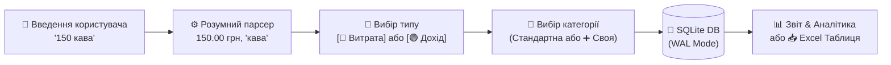

<div align="center">

# 🪙 FinFlow Bot

### Сучасний, швидкий та автономний Telegram-бот для персонального обліку фінансів

[](https://www.python.org/)
[](https://docs.aiogram.dev/)
[](https://www.sqlite.org/)
[](https://www.docker.com/)
[](LICENSE)

<br/>

**FinFlow** дозволяє вести облік витрат і доходів буквально в один дотик: надсилайте звичайні текстові повідомлення на зразок `150 кава`, обирайте категорію інтерактивними кнопками, створюйте власні теги та миттєво експортуйте зведені звіти в гарний **Excel (.xlsx)**.

</div>

---

## 🌟 Ключові можливості

| Можливість | Опис |
| :--- | :--- |
| ⚡ **Natural Input** | Розумний парсер витягує суму й опис із довільного тексту: `150 кава`, `таксі 250`, `1 500 грн подарунок`, `350.50 Сільпо`. |
| 🔘 **Інтерактивні інлайн-кнопки** | Миттєве перемикання між 🔴 **Витратами** та 🟢 **Доходами** зі зручною розкладкою категорій. |
| 🏷️ **Кастомні категорії** | Можливість створювати власні унікальні категорії (*«Книги»*, *«Косметика»*, *«Хобі»*) прямо під час внесення операції. |
| 📊 **Глибока аналітика** | Статистика за **День**, **Тиждень**, **Місяць** та **Рік** із сумами, балансом і процентним розподілом за кожною категорією. |
| 📥 **Експорт в Excel (.xlsx)** | Генерація професійно оформленої таблиці з автопідбором ширини колонок, кольоровим виділенням та грошовим форматом. |
| 👥 **Multi-User Isolation** | Повна приватність: кожен користувач працює у власному ізольованому просторі зі своїми записами та власними категоріями. |
| 🛡️ **Конфіденційність** | Усі фінансові дані зберігаються у локальній базі даних SQLite без передачі на сторонні сервери. |

---

## 📱 Як це працює



### Приклад щоденної взаємодії:

1. **Запис транзакції:**
   ```text
   Ви: 180 ланч з колегами
   Бот: 💰 Сума: 180.00 грн | 📝 Опис: ланч з колегами
        [🔴 Витрата]   [🟢 Дохід]
   ```
2. **Вибір категорії:**
   ```text
   [🛒 Продукти]       [☕ Кафе / Ресторани]
   [🚕 Транспорт]      [🏠 Житло / Комуналка]
   [🛍️ Покупки]        [💊 Здоров'я]
   [➕ Своя категорія] [⬅️ Назад]
   ```
3. **Миттєве підтвердження:**
   ```text
   ✅ Витрату успішно збережено!
   💰 Сума: 180.00 грн
   📁 Категорія: ☕ Кафе / Ресторани
   📝 Опис: ланч з колегами
   [🗑️ Видалити цей запис]
   ```

---

## 🛠️ Стек технологій

- **Мова програмування:** Python 3.10+
- **Telegram Framework:** [aiogram 3.x](https://github.com/aiogram/aiogram) (асинхронний, побудований на asyncio)
- **База даних:** SQLite3 у режимі **WAL** (Write-Ahead Logging) для швидкого багатокористувацького доступу
- **Генерація таблиць:** [openpyxl](https://openpyxl.readthedocs.io/)
- **Контейнеризація:** Docker / Docker Compose
- **Проксі-підтримка:** Автоматичне виявлення HTTP/HTTPS проксі (ідеально для безкоштовного хостингу на PythonAnywhere)

---

## 📂 Структура проєкту

```text
fin-app/
├── 📄 main.py              # Точка входу, роутери та обробники повідомлень/callback-ів
├── 📄 database.py          # SQLite шар: таблиці транзакцій, категорій та аналітика
├── 📄 keyboards.py         # Генератори інлайн- та реплай-клавіатур
├── 📄 parser.py            # Інтелектуальний парсер тексту та чисел
├── 📄 excel_exporter.py    # Стилізація та формування .xlsx документів
├── 📄 config.py            # Завантаження конфігурації та безпека оточення
├── 🐳 Dockerfile           # Контейнеризація для легкого деплою
├── ⚙️ finbot.service       # Шаблон служби systemd для Linux VPS
├── 📄 requirements.txt     # Залежності проєкту
└── 📄 README.md            # Документація проєкту
```

---

## 🚀 Швидкий запуск

### 1. Клонування репозиторію
```bash
git clone https://github.com/ВАШ_КОРИСТУВАЧ/fin-app.git
cd fin-app
```

### 2. Створення віртуального оточення та встановлення залежностей
```bash
# Створення venv
python -m venv .venv

# Активація (Windows)
.\.venv\Scripts\activate

# Активація (Linux / macOS)
source .venv/bin/activate

# Встановлення пакетів
pip install -r requirements.txt
```

### 3. Налаштування токена бота
Отримайте токен у [@BotFather](https://t.me/BotFather) в Telegram.

Створіть файл `.env` у корені проєкту:
```env
BOT_TOKEN=1234567890:ABCdefGHIjklMNOpqrsTUVwxyz
```

### 4. Запуск
```bash
python main.py
```

---

## 🐳 Запуск через Docker

Якщо ви віддаєте перевагу Docker:

```bash
# Збірка образу
docker build -t finflow-bot .

# Запуск контейнера зі збереженням бази даних на хості
docker run -d --name finflow-app --restart always -v $(pwd)/data:/app -e BOT_TOKEN=ваш_токен finflow-bot
```

---

## ☁️ Деплой 24/7 (Хостинг)

> [!TIP]
> Проєкт уже має вбудовану оптимізацію для запуску на безкоштовному акаунті **PythonAnywhere** та готовий файл конфігурації **systemd** ([finbot.service](finbot.service)) для будь-якого Linux VPS (Hetzner, DigitalOcean, Oracle Cloud).

---

## 📄 Ліцензія

Цей проєкт поширюється під ліцензією [MIT](LICENSE). Ви можете вільно використовувати, модифікувати та розгортати його для особистих чи комерційних цілей.
